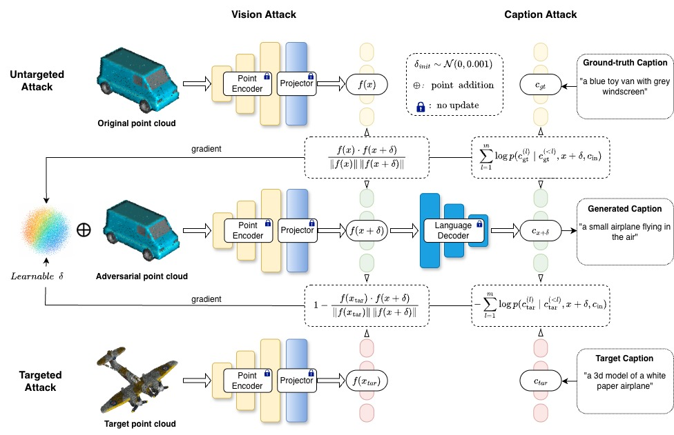
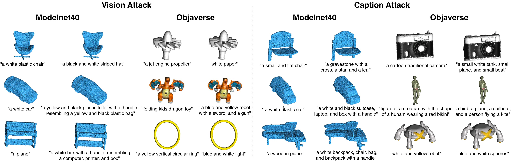

<div align="center">

# On the Adversarial Robustness of 3D Large Vision-Language Models

**Chao Liu, Ngai-Man Cheung**

[](https://arxiv.org/abs/2601.06464)

</div>

This repository contains the official code for the paper
[**On the Adversarial Robustness of 3D Large Vision-Language Models**](https://arxiv.org/abs/2601.06464).

We present the first systematic study of adversarial robustness in point-based 3D vision-language models (3D VLMs), such as **PointLLM** and **GPT4Point**. We propose two attack strategies, each with **untargeted** and **targeted** variants:

- **Vision Attack**: perturbs the input point cloud so that the visual token features produced by the 3D encoder and projector are pushed away from (untargeted) or toward (targeted) a reference.
- **Caption Attack**: directly manipulates the output token sequence of the language model.

Our experiments show that 3D VLMs are highly vulnerable to untargeted attacks, but more resistant than 2D VLMs to targeted attacks that force specific outputs.

<p align="center">
  
</p>

## Examples

**Untargeted attack**

<p align="center">
  
</p>

## Repository Structure

```
Attackon3DVLMs/
├── attack_methods/
│   ├── _train_adv_pc_HiT_.py      # Generate adversarial point clouds (HiT-ADV style shape attack)
│   ├── _train_adv_pc_native_.py   # Generate adversarial examples with native point / feature perturbation
│   ├── _eval_adv_pc_HiT_.py       # Evaluate saved adversarial point clouds
│   ├── ShapeAttack/               # HiT_ADV and Native_ADV attackers
│   ├── FGM/                       # FGSM / FGM-L2 baselines
│   ├── evaluation/                # Losses, model generators, GPT-based & traditional caption evaluators
│   ├── pointnet2_ops_lib/         # PointNet++ CUDA ops
│   └── util/                      # Distance metrics, CLIP and misc utilities
├── victim_models/
│   ├── pointllm/                  # PointLLM
│   └── gpt4point/                 # GPT4Point
├── dataset/
│   ├── data/                      # ModelNet40 / Objaverse dataloaders
│   ├── preprocess/                # Point-cloud processing and ori/target pair sampling
│   ├── Modelnet40/                # ModelNet40-specific helpers
│   └── Objaverse/                 # Objaverse-specific helpers
├── environment.yml
└── pyproject.toml
```

## Installation

```bash
git clone <this-repo-url> Attackon3DVLMs
cd Attackon3DVLMs

# Option 1: conda environment (Python 3.10, CUDA 11.8)
conda env create -f environment.yml
conda activate GPT4Point

# Option 2: pip
pip install -e .

# Build PointNet++ ops
cd attack_methods/pointnet2_ops_lib && pip install . && cd ../..
```

GPT-based caption evaluation uses the OpenAI API:

```bash
export OPENAI_API_KEY=<your-key>
```

## Data Preparation

We use **ModelNet40** for zero-shot classification and **Objaverse** (with PointLLM brief-description annotations) for captioning.

1. Download the ModelNet40 test set (8192 points, FPS-sampled) and the Objaverse point clouds / annotations released by [PointLLM](https://github.com/OpenRobotLab/PointLLM).
2. Build the original / target point-cloud pairs:

```bash
cd dataset/preprocess
# edit the paths in the scripts first
bash process_pointcloud.sh
bash uniform_sample_ori_and_tgt_pc.sh
```

## Victim Models

- **PointLLM**: e.g. `RunsenXu/PointLLM_7B_v1.2` (Hugging Face)
- **GPT4Point**: `gpt4point_opt2.7b`

Put downloaded checkpoints under `checkpoints/` (ignored by git), following the instructions of each model's original repository.

## Usage

Run all scripts from the repository root.

### Generate adversarial examples

```bash
# Vision attack, untargeted, ModelNet40 classification
python -m attack_methods._train_adv_pc_HiT_ \
    --model_type gpt4point_opt2.7b \
    --dataset_type ModelNet \
    --task_type classification \
    --attack_method vision_attack \
    --ori_data_path <path/to/ori_pc> \
    --tgt_data_path <path/to/tgt_pc> \
    --output_pc_path <path/to/save/adv_pc>

# Caption attack, targeted, Objaverse captioning
python -m attack_methods._train_adv_pc_HiT_ \
    --model_name RunsenXu/PointLLM_7B_v1.2 --model_type pointllm \
    --dataset_type Objaverse \
    --task_type captioning \
    --attack_method caption_attack --is_targeted \
    --ori_data_path <path/to/ori_pc> --ori_anno_path <ori_anno.json> \
    --tgt_data_path <path/to/tgt_pc> --tgt_anno_path <tgt_anno.json> \
    --output_pc_path <path/to/save/adv_pc>
```

Use `_train_adv_pc_native_.py` for native perturbations, with `--perturbate_object {pc,feature}` and `--budget` to control the perturbation.

Key options:

| Argument | Description |
| --- | --- |
| `--attack_method` | `vision_attack` or `caption_attack` |
| `--is_targeted` | Targeted attack (default: untargeted) |
| `--task_type` | `classification` or `captioning` |
| `--dataset_type` | `ModelNet` or `Objaverse` |
| `--start_gpt_eval --gpt_type` | GPT-based evaluation (`gpt-4o-mini`, `gpt-5-nano`) |
| `--wandb` | Log to Weights & Biases |

### Evaluate adversarial examples

```bash
python -m attack_methods._eval_adv_pc_HiT_ \
    --model_type gpt4point_opt2.7b \
    --dataset_type ModelNet \
    --task_type classification \
    --attack_method vision_attack \
    --adv_data_path <path/to/adv_pc> \
    --start_pc_eval
```

## Acknowledgements

This codebase builds on [PointLLM](https://github.com/OpenRobotLab/PointLLM), [GPT4Point](https://github.com/Pointcept/GPT4Point), [HiT-ADV](https://github.com/TRLou/HiT-ADV), and [Pointnet2_PyTorch](https://github.com/erikwijmans/Pointnet2_PyTorch). We thank the authors for releasing their code.

## Citation

If you find this work useful, please cite:

```bibtex
@article{liu2026adversarial,
  title   = {On the Adversarial Robustness of 3D Large Vision-Language Models},
  author  = {Liu, Chao and Cheung, Ngai-Man},
  journal = {arXiv preprint arXiv:2601.06464},
  year    = {2026}
}
```
